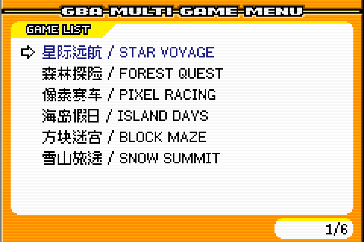
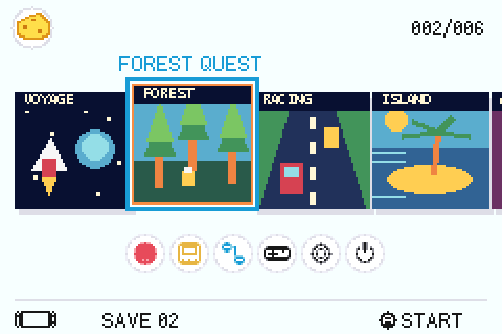
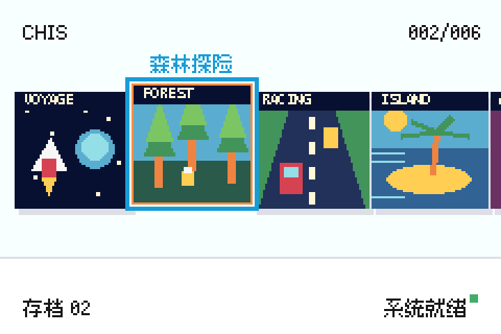
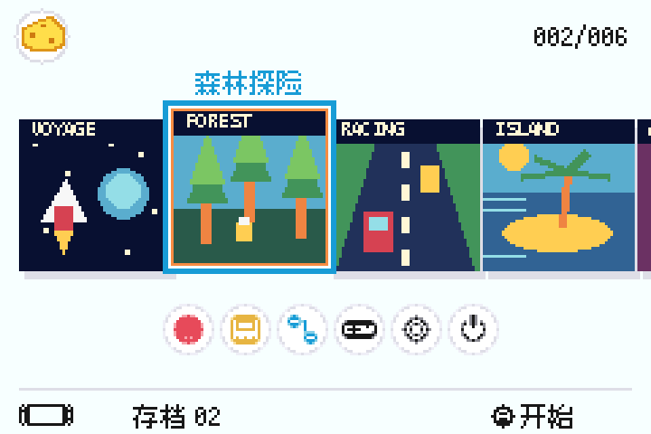

# ChisFlash Multicart Menus

[](README.zh-CN.md)

Four GBA multicart menus for ChisFlash: **LK, LK Waterline, NS, and NS Lite**.

[Previews](#previews) · [Download menus](https://github.com/ChisLightyear/ChisFlash-Multicart-Menus/releases)

## Menu selection

This repository contains source code, required assets, and build files for all four menus. Download compiled menu ROMs from [Releases](https://github.com/ChisLightyear/ChisFlash-Multicart-Menus/releases).

| Directory | Menu | Features | Release file |
|---|---|---|---|
| `LK/` | LK | Classic list interface for traditional multicart layouts | `lk_multimenu.gba` |
| `LK-WL/` | LK Waterline | Classic list interface with fragmented block mapping on compatible hardware | `wl_magic_menu.gba` |
| `NS/` | NS | Covers, settings, capacity display, and switchable Chinese/English UI | `universal_menu.gba` |
| `NS-Lite/` | NS Lite | Simplified layout with a fixed Chinese UI | `simplified_ns_menu.gba` |

Choose a menu that matches your cartridge hardware and existing image layout. Fragmented mapping requires compatible hardware and tools. LK and LK Waterline share the classic interface; their main difference is the supported image layout and mapping method.

## Download and use

Download an individual menu or the four-menu bundle from [Releases](https://github.com/ChisLightyear/ChisFlash-Multicart-Menus/releases), then import or update it using a compatible ChisFlash client or multicart builder.

Menu ROMs contain no games. To update an existing cartridge, use the tool's menu-update function. Do not flash a standalone menu ROM as though it were a complete multicart image.

## Build

Install devkitPro, devkitARM, and libgba. In a terminal configured for the toolchain, run:

```sh
make
```

To build one menu, specify `LK`, `LK-WL`, `NS`, or `NS-Lite`, for example:

```sh
make NS
```

Output files are written to the corresponding subdirectory under `.build/`.

## Startup compatibility fix

`v2026.11.09-r3` gives all four menus a complete startup cleanup: stop interrupts, DMA, and timers, then use the BIOS to clear IWRAM/EWRAM and reset hardware state before entering the game. Cartridge mapping and SRAM saves are preserved. This fixes the iQue Metroid: Zero Mission build freezing at its health advisory screen, while retaining the Mario Kart and Gunstar Super Heroes fixes.

LK and LK Waterline also use faster font rendering and a glyph-index cache. Key presses are sampled during VBlank and retained while a page is being redrawn. In mGBA comparisons using the same Chinese list, up/down redraws fell from 7 to 3 frames (about 50 ms), and full-page redraws from 19 to 6 frames (about 100 ms), with identical final pixels. Repeated presses approximately 100 ms apart passed up/down, page-boundary, and wraparound checks.

All four menus were tested with a functional 01G Verilog model, mGBA, and a real GBA BIOS dump, successfully reaching a Mario Kart race and playable stages in Gunstar Super Heroes and iQue Metroid: Zero Mission. Traditional, WL, and universal mapping startup combinations, as well as recovery after a failed launch, were also checked.

## License

Menu code retains the **GNU GPL v3** license; see [LICENSE](LICENSE) and the license files in each menu directory. Fonts and other assets retain their respective licenses and credits.

## Previews

Actual mGBA captures of the released menus, using demonstration titles and original pixel-art covers. These are emulator screenshots, not hardware photographs. The native 240 × 160 frames are enlarged by an integer scale factor.

| LK | LK Waterline |
|---|---|
|  |  |
| **NS** | **NS Lite** |
|  |  |

**NS Chinese interface**



## Acknowledgements

Special thanks to **[Lesserkuma](https://github.com/Lesserkuma)**, author of the original **[GBA Multi Game Menu](https://github.com/Lesserkuma/GBA_MultiMenu)** on which this project is based, and to **[ZaindORp / orzgithub](https://github.com/orzgithub)** for extending and maintaining **[GBA_MultiMenu_extended](https://github.com/orzgithub/GBA_MultiMenu_extended)**.

This project builds on their work with ChisFlash adaptations, additional interfaces, and compatibility fixes. Original credits and licenses are retained. Thank you to the original authors and open-source contributors.
