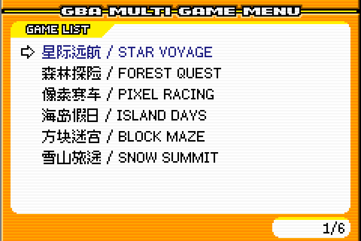
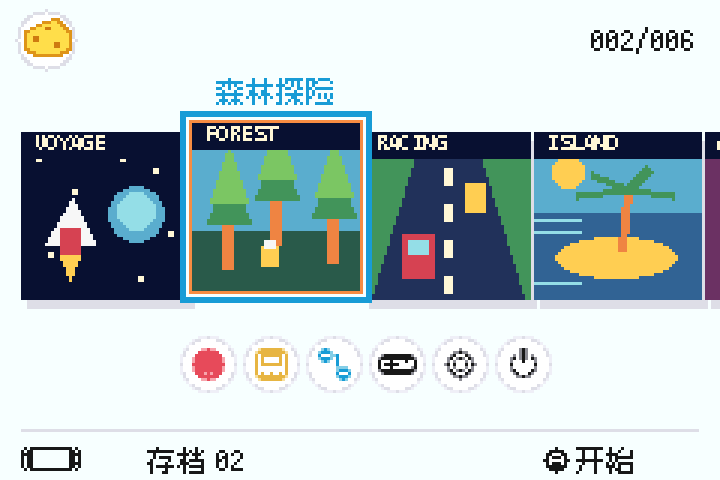
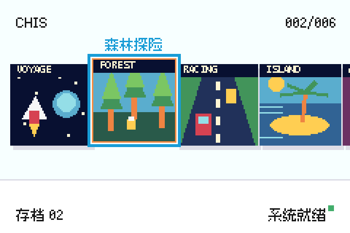
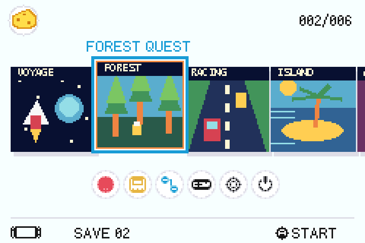

# ChisFlash Multicart Menus

[简体中文](#简体中文) · [English](#english) · [截图 / Screenshots](#预览--previews) · [下载 / Releases](https://github.com/ChisLightyear/ChisFlash-Multicart-Menus/releases)

ChisFlash GBA 合卡菜单合集：**LK、LK 水线、NS 完整版、精简 NS**。

Four GBA multicart menus for ChisFlash: **LK, LK Waterline, NS, and NS Lite**.

## 鸣谢 / Acknowledgements

特别感谢 **[Lesserkuma](https://github.com/Lesserkuma)** 创作的 **[GBA Multi Game Menu](https://github.com/Lesserkuma/GBA_MultiMenu)**，它是本项目所基于的原始 LK 菜单。感谢 **[ZaindORp / orzgithub](https://github.com/orzgithub)** 对 **[GBA_MultiMenu_extended](https://github.com/orzgithub/GBA_MultiMenu_extended)** 的扩展与维护。

Special thanks to **[Lesserkuma](https://github.com/Lesserkuma)**, author of the original **[GBA Multi Game Menu](https://github.com/Lesserkuma/GBA_MultiMenu)** on which this project is based, and to **[ZaindORp / orzgithub](https://github.com/orzgithub)** for extending and maintaining **[GBA_MultiMenu_extended](https://github.com/orzgithub/GBA_MultiMenu_extended)**.

本项目在上述工作的基础上进行 ChisFlash 适配、界面扩展及兼容性修复，保留原作者署名和许可证。感谢原作者及相关开源贡献者的付出。

This project builds on their work with ChisFlash adaptations, additional interfaces, and compatibility fixes. Original credits and licenses are retained. Thank you to the original authors and open-source contributors.

## 预览 / Previews

以下为本次发布菜单在 mGBA 中的实际运行截图，使用演示标题和自制像素封面；不是实卡拍摄。原始分辨率为 240 × 160，按整数倍放大。

Actual mGBA captures of the released menus, using demonstration titles and original pixel-art covers. These are emulator screenshots, not hardware photographs. The native 240 × 160 frames are enlarged by an integer scale factor.

| LK 菜单 / LK | LK 水线菜单 / LK Waterline |
|---|---|
|  |  |
| **NS 完整版 / NS** | **精简 NS / NS Lite** |
|  |  |

**NS 英文界面 / NS English interface**



## 简体中文

本仓库提供四套菜单的源码、必要资源与构建文件。编译好的菜单在 [Releases](https://github.com/ChisLightyear/ChisFlash-Multicart-Menus/releases) 下载。

| 目录 | 菜单 | 说明 | Release 文件 |
|---|---|---|---|
| `LK/` | LK 菜单 | 经典列表界面，普通合卡布局 | `lk_multimenu.gba` |
| `LK-WL/` | LK 水线菜单 | 经典列表界面，支持配套硬件的碎片映射布局 | `wl_magic_menu.gba` |
| `NS/` | NS 完整版 | 封面、设置与容量显示，支持中英文界面切换 | `universal_menu.gba` |
| `NS-Lite/` | 精简 NS | 精简布局，固定中文界面 | `simplified_ns_menu.gba` |

请根据卡带硬件及现有合卡布局选择菜单。碎片映射需要硬件和工具共同支持。LK 与 LK 水线采用相同的经典界面，两者的主要区别是合卡布局和映射方式。

### 下载与使用

从 [Releases](https://github.com/ChisLightyear/ChisFlash-Multicart-Menus/releases) 下载单个菜单或四款合包，通过匹配的 ChisFlash 上位机或合卡器导入、更新菜单。

菜单文件不包含游戏。更新已有卡带时，请使用工具的菜单更新功能，不要把裸菜单文件当作完整合卡镜像整卡覆盖。

### 编译

准备 devkitPro、devkitARM 和 libgba，在配置好工具链的终端中执行 `make` 编译全部菜单，或执行 `make NS` 等命令编译单款菜单。支持的目标为 `LK`、`LK-WL`、`NS`、`NS-Lite`，输出位于 `.build/` 下对应目录。

### 启动兼容性修复

`v2026.11.09` 统一修正四套菜单交接游戏前的中断状态，避免部分游戏在初始化完成前提前进入中断，造成黑屏或异常启动。马里奥赛车汉化版跳过开场图后的黑屏是本次修复案例。

四套菜单已通过 01G Verilog 功能仿真与 mGBA、真实 GBA BIOS 联调，能够进入马里奥赛车赛道；另已验证普通、WL 和通用映射启动组合。本版尚未完成实卡验证，详细验证范围见 Release。

### 许可证

菜单代码沿用 **GNU GPL v3**，见 [LICENSE](LICENSE) 及各菜单目录中的许可证。字体等资源保留各自的许可证和署名。

## English

This repository contains source code, required assets, and build files for all four menus. Download compiled menu ROMs from [Releases](https://github.com/ChisLightyear/ChisFlash-Multicart-Menus/releases).

| Directory | Menu | Features | Release file |
|---|---|---|---|
| `LK/` | LK | Classic list interface for traditional multicart layouts | `lk_multimenu.gba` |
| `LK-WL/` | LK Waterline | Classic list interface with fragmented block mapping on compatible hardware | `wl_magic_menu.gba` |
| `NS/` | NS | Covers, settings, capacity display, and switchable Chinese/English UI | `universal_menu.gba` |
| `NS-Lite/` | NS Lite | Simplified layout with a fixed Chinese UI | `simplified_ns_menu.gba` |

Choose a menu that matches your cartridge hardware and existing image layout. Fragmented mapping requires compatible hardware and tools. LK and LK Waterline share the classic interface; their main difference is the supported image layout and mapping method.

### Download and use

Download an individual menu or the four-menu bundle from [Releases](https://github.com/ChisLightyear/ChisFlash-Multicart-Menus/releases), then import or update it using a compatible ChisFlash client or multicart builder.

Menu ROMs contain no games. To update an existing cartridge, use the tool's menu-update function. Do not flash a standalone menu ROM as though it were a complete multicart image.

### Build

Install devkitPro, devkitARM, and libgba. In a terminal configured for the toolchain, run:

```sh
make
```

To build one menu, specify `LK`, `LK-WL`, `NS`, or `NS-Lite`, for example:

```sh
make NS
```

Output files are written to the corresponding subdirectory under `.build/`.

### Startup compatibility fix

`v2026.11.09` corrects interrupt state before handing control to a game in all four menus. This prevents interrupts from firing before game initialization is complete, which can cause a black screen or abnormal startup. The reported case was a Chinese translation of Mario Kart that went black after its introductory splash screen.

All four menus were tested with a functional 01G Verilog model, mGBA, and a real GBA BIOS dump, successfully reaching a race. Traditional, WL, and universal mapping startup combinations were also checked. This release has not yet been verified on physical cartridges; see the Release notes for test coverage.

### License

Menu code retains the **GNU GPL v3** license; see [LICENSE](LICENSE) and the license files in each menu directory. Fonts and other assets retain their respective licenses and credits.
