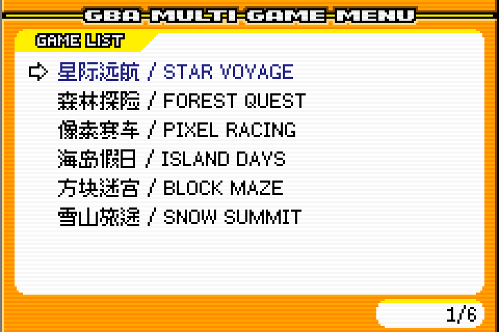
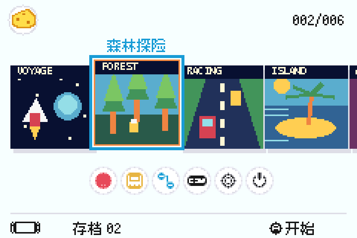
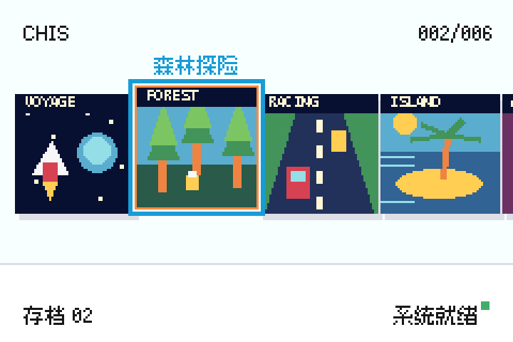
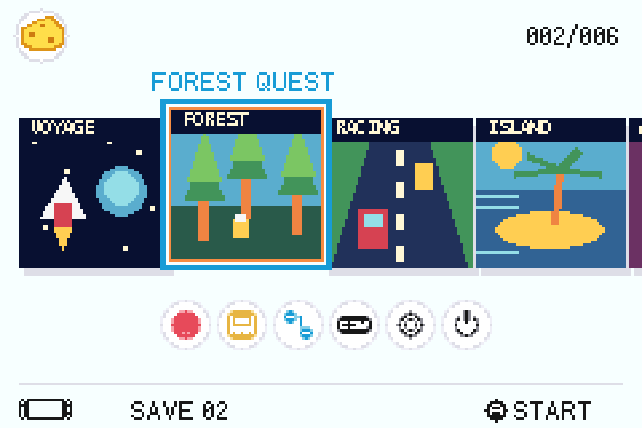

# ChisFlash GBA 合卡菜单

[English](README.md) | [简体中文](README.zh-CN.md)

ChisFlash GBA 合卡菜单合集，包括 **LK、LK 水线、NS 完整版和精简 NS**。

[预览](#预览) · [下载菜单](https://github.com/ChisLightyear/ChisFlash-Multicart-Menus/releases)

## 菜单选型

本仓库提供四套菜单的源码、必要资源与构建文件。编译好的菜单在 [Releases](https://github.com/ChisLightyear/ChisFlash-Multicart-Menus/releases) 下载。

| 目录 | 菜单 | 说明 | Release 文件 |
|---|---|---|---|
| `LK/` | LK 菜单 | 经典列表界面，普通合卡布局 | `lk_multimenu.gba` |
| `LK-WL/` | LK 水线菜单 | 经典列表界面，支持配套硬件的碎片映射布局 | `wl_magic_menu.gba` |
| `NS/` | NS 完整版 | 封面、设置与容量显示，支持中英文界面切换 | `menu_NS.gba` |
| `NS-Lite/` | 精简 NS | 精简布局，固定中文界面 | `menu_NSLite.gba` |

两款 NS 菜单都能读取 Ausar CHDR 游戏列表，并显示已导入的封面。水线固件支持菜单文件名前缀时，可通过 USB 直接拖入任一 NS 菜单替换当前菜单。卡上统一显示为 `menu.gba`。

请根据卡带硬件及现有合卡布局选择菜单。碎片映射需要硬件和工具共同支持。LK 与 LK 水线采用相同的经典界面，两者的主要区别是合卡布局和映射方式。

## 下载与使用

从 [Releases](https://github.com/ChisLightyear/ChisFlash-Multicart-Menus/releases) 下载单个菜单或四款合包，通过匹配的 ChisFlash 上位机或合卡器导入、更新菜单。

菜单文件不包含游戏。更新已有卡带时，请使用工具的菜单更新功能，不要把裸菜单文件当作完整合卡镜像整卡覆盖。

## 编译

准备 devkitPro、devkitARM 和 libgba，在配置好工具链的终端中执行 `make` 编译全部菜单，或执行 `make NS` 等命令编译单款菜单。支持的目标为 `LK`、`LK-WL`、`NS`、`NS-Lite`，输出位于 `.build/` 下对应目录。

## 启动兼容性修复

`v2026.11.09-r3` 为四套菜单统一加入完整启动清理：关闭中断、DMA 和定时器，通过 BIOS 清空 IWRAM、EWRAM 并重置硬件状态，再进入游戏。卡带映射与 SRAM 存档保留。修复神游《密特罗德：零点任务》停在健康游戏提示页的问题，同时保留马里奥赛车、超级火枪英雄的启动修复。

LK 与 LK 水线版同时优化字体绘制和字形索引缓存，并在 VBlank 中采集按键，保留翻页重绘期间的短按。相同中文列表的 mGBA 对照中，上下重绘从 7 帧降至 3 帧（约 50 ms），整页重绘从 19 帧降至 6 帧（约 100 ms），画面逐像素一致；约每 100 ms 一次的连续上下、跨页及首尾循环测试通过。

四套菜单已通过 01G Verilog 功能仿真与 mGBA、真实 GBA BIOS 联调，能够进入马里奥赛车赛道、超级火枪英雄及神游零点任务的实际关卡；另已验证普通、WL 和通用映射启动组合，以及启动失败后返回菜单。

## 许可证

菜单代码沿用 **GNU GPL v3**，见 [LICENSE](LICENSE) 及各菜单目录中的许可证。字体等资源保留各自的许可证和署名。

## 预览

以下为本次发布菜单在 mGBA 中的实际运行截图，使用演示标题和自制像素封面；不是实卡拍摄。原始分辨率为 240 × 160，按整数倍放大。

| LK 菜单 | LK 水线菜单 |
|---|---|
|  |  |
| **NS 完整版** | **精简 NS** |
|  |  |

**NS 英文界面**

## 鸣谢

特别感谢 **[Lesserkuma](https://github.com/Lesserkuma)** 创作的 **[GBA Multi Game Menu](https://github.com/Lesserkuma/GBA_MultiMenu)**，它是本项目所基于的原始 LK 菜单。感谢 **[ZaindORp / orzgithub](https://github.com/orzgithub)** 对 **[GBA_MultiMenu_extended](https://github.com/orzgithub/GBA_MultiMenu_extended)** 的扩展与维护。

本项目在上述工作的基础上进行 ChisFlash 适配、界面扩展及兼容性修复，保留原作者署名和许可证。感谢原作者及相关开源贡献者的付出。
